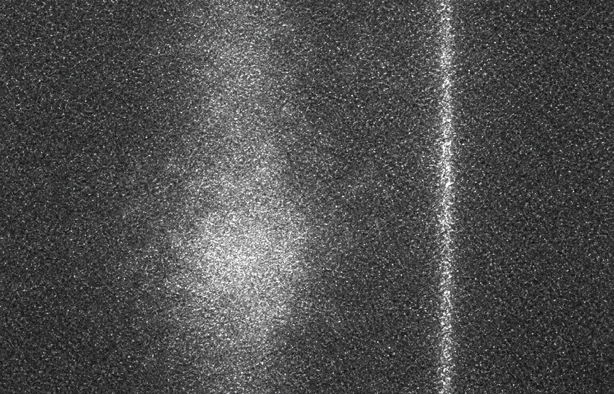

# BioFlowSim

**BioFlowSim** is a Python research software project for simulating two-dimensional particle flow in microfluidic channels and supporting computational experiments involving synthetic imaging data.

The project provides a modular framework for exploring particle motion, flow behavior, and computational approaches to biomedical imaging.

## Visual Preview



*Example grayscale speckle image associated with BioFlowSim.*

## Features

- **2D Particle Flow Simulation**
  - Configurable particle count, simulation dimensions, base velocity, and diffusion
  - Boundary handling and circular obstacle support
  - Reproducible simulations with configurable random seeds

- **Synthetic Imaging**
  - Imaging utilities for computational experiments
  - Support for synthetic imaging workflows, according to implemented functionality

- **Machine Learning Applications**
  - Utilities for preparing and exploring synthetic data
  - A modular foundation for computational imaging workflows

- **Visualization and Analysis**
  - Tools for examining particle trajectories and simulation outputs
  - Separate visualization and analysis modules

## Installation

Clone the repository and install BioFlowSim in editable mode:

```bash
git clone https://github.com/AMatelis/BioFlowSim.git
cd BioFlowSim
python -m pip install -e .
```

## Quick Start

The following example runs a particle-flow simulation and returns particle trajectories, frame-to-frame velocity changes, and collision flags.

```python
from bioflowsim.simulation import FlowSimulator

sim = FlowSimulator(
    num_particles=50,
    frames=100,
    width=256,
    height=256,
    base_velocity=(0.5, 0.2),
    diffusion=0.05,
    random_seed=42,
)

trajectories, velocities, collisions = sim.run()

print("Trajectories:", trajectories.shape)
print("Velocities:", velocities.shape)
print("Collision flags:", collisions.shape)
```

For this example, the output shapes are `(100, 50, 2)`, `(100, 50, 2)`, and `(100, 50)`, respectively.

## Example Notebook

Explore the demonstration notebook:

[`examples/simple_flow_demo.ipynb`](examples/simple_flow_demo.ipynb)

## Project Structure

```text
BioFlowSim/
├── .github/
│   └── workflows/
├── docs/
├── examples/
├── src/
│   └── bioflowsim/
├── tests/
├── assets/
├── requirements.txt
├── setup.py
├── LICENSE
└── README.md
```

## Testing

Run the test suite from the repository root:

```bash
python -m pytest
```

The tests cover simulation behavior, output shapes, reproducibility, and imaging functionality.

## Scientific Motivation

Synthetic imaging data provides a controlled environment for studying how particle motion and imaging conditions affect computational analysis. BioFlowSim aims to support experimentation in microfluidic flow simulation and computational biomedical imaging.

## Development Status

BioFlowSim is an actively developed research software project. Its capabilities may evolve as the simulation framework and imaging utilities are extended.
 
## Author

**Andrew Matelis**

- GitHub: [@AMatelis](https://github.com/AMatelis)
- Repository: [BioFlowSim](https://github.com/AMatelis/BioFlowSim)

## License

See the [`LICENSE`](LICENSE) file for licensing terms.
